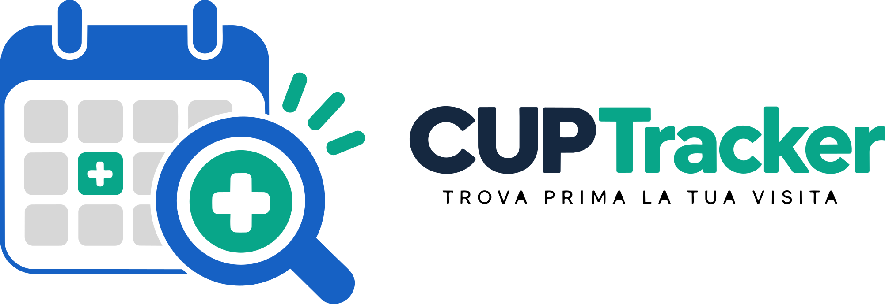
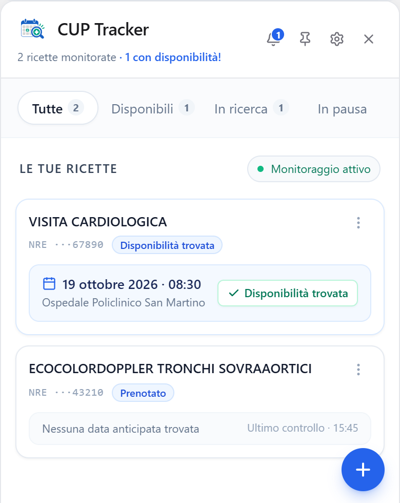

### Trova una visita senza controllare continuamente il CUP.

CUP Tracker monitora le disponibilità per visite ed esami medici,
ti avvisa quando trova un appuntamento disponibile e ti lascia decidere se prenotare.

**Gratuito** · **Open source (Apache 2.0)** · **App desktop per Windows** · **Dati sul tuo computer**

[cuptracker.r3dsi.com](https://cuptracker.r3dsi.com)

---

> **Stato del progetto: pre-lancio.** Stiamo completando l’installer per Windows e le ultime verifiche. Il download non è ancora disponibile e non abbiamo annunciato una data di rilascio. Per ora questo repository presenta il progetto: il codice sorgente sarà pubblicato qui con licenza Apache 2.0.
>
> CUP Tracker è un progetto indipendente di R3DSI, non affiliato né finanziato dalla Regione Liguria, dalla Regione Toscana o da enti sanitari. Non è un servizio sanitario ufficiale.

## Perché nasce

Cercare una visita o un esame può significare tornare sul portale più volte al giorno, controllare le stesse sedi e sperare che si liberi un posto. CUP Tracker nasce da questa esperienza concreta: rendere più semplice accorgersi di una disponibilità utile, anche per chi non ha competenze tecniche o aiuta un familiare.

**Sarà gratuito.** Non vogliamo lucrare sull’accesso alle cure: niente abbonamenti né funzioni a pagamento. L’eventuale ticket sanitario si paga direttamente all’ente sanitario tramite pagoPA, come previsto dal servizio.

## Come funziona

1. **Parti dalla tua prescrizione.** Ti serve una ricetta elettronica (impegnativa) per la visita o l’esame.
2. **Configura il monitoraggio.** Scegli periodo, fascia oraria, giorni feriali ed eventuale sede preferita. Se hai già un appuntamento, puoi cercare solo date precedenti.
3. **CUP Tracker verifica le disponibilità.** Dal tuo computer consulta periodicamente il portale CUP, con controlli distanziati. L’app deve restare aperta, anche in background, e connessa a Internet.
4. **Ricevi l’avviso e decidi tu.** Quando trova un appuntamento disponibile ricevi una notifica con date, orari e sedi, e prenoti attraverso i canali ufficiali del CUP.

**Nessuna prenotazione viene effettuata automaticamente.** Il monitoraggio cerca e avvisa: non prenota, non cambia e non annulla appuntamenti. Un avviso non riserva il posto: la disponibilità può cambiare prima che tu prenoti.

 
Schermata reale dell’app in modalità dimostrativa: dati fittizi e disponibilità simulate. L’interfaccia può cambiare prima del rilascio.

## Funzionalità

| Funzione | Stato |
| :--- | :--- |
| Monitoraggio delle disponibilità per la tua ricetta | Prima versione |
| Ricerca di date anticipate rispetto a un appuntamento esistente | Prima versione |
| Notifiche nell’app e, se vuoi, su Telegram | Prima versione |
| Più profili, per te e per familiari che ti hanno autorizzato | Prima versione |
| Periodo, fascia oraria, giorni feriali e sede preferita | Prima versione |
| Prenotazione dall’app, sempre con la tua conferma | In arrivo |
| Documenti e promemoria degli appuntamenti | In arrivo |

CUP Tracker non crea disponibilità e non garantisce tempi di attesa: ti aiuta ad accorgerti dei posti che il CUP rende disponibili. La prenotabilità online dipende dalla ricetta e dal portale regionale.

## Profili per te e per chi aiuti

Puoi creare profili separati per te, un genitore, il partner o un’altra persona che ti ha autorizzato. Ogni profilo ha le proprie ricette e preferenze. Gestire il profilo di un’altra persona richiede il suo consenso: avere i suoi dati non sostituisce questa autorizzazione.

## I tuoi dati

- **Conservati sul tuo computer.** Profili, ricette e appuntamenti sono salvati in un archivio cifrato con AES-256-GCM, con la chiave protetta da Windows DPAPI. R3DSI non gestisce server che ricevono questi dati e non serve creare un account. L’app non include telemetria o analytics.
- **Comunicazioni con il CUP.** Salvataggio locale non significa assenza di comunicazioni: per cercare disponibilità l’app invia via HTTPS, direttamente al portale regionale, i dati richiesti dal servizio (ad esempio codice fiscale, parte del numero di tessera sanitaria, recapito e numero di ricetta).
- **Telegram è facoltativo.** Se lo attivi, le notifiche passano dai server di Telegram tramite il tuo bot personale e contengono solo l’alias del profilo oppure il nome, con date, orari e sedi. Non contengono cognome, codice fiscale, tessera sanitaria, numero di ricetta o codici di prenotazione.

## Uso responsabile

CUP Tracker usa solo le funzioni di consultazione che il portale offre a ogni cittadino, con i dati dell’assistito, come farebbe una persona dal proprio computer:

- controlli distanziati di **almeno 30 minuti** per ricetta, sospesi temporaneamente quando il CUP segnala limiti o errori;
- l’app si identifica come CUP Tracker, senza fingersi un browser;
- nessun tentativo di aggirare blocchi, code o protezioni del portale.

## Regioni e sviluppi futuri

| Area | Stato |
| :--- | :--- |
| **Liguria** | Prima regione prevista: integrazione con PrenotoSalute nelle fasi finali di sviluppo e verifica. |
| **Toscana** | Supporto ancora in sviluppo: il monitoraggio non sarà disponibile nella prima versione. |
| **Altre regioni** | Obiettivo futuro, senza date o copertura garantite. |

Tappe previste, senza date di rilascio:

1. Prima versione desktop per Windows, con supporto alla Liguria.
2. Prenotazione dall’app, sempre con la tua conferma, con documenti e promemoria.
3. Completamento del supporto alla Toscana.
4. Estensione ad altre regioni.
5. Applicazione mobile, con i dati conservati sul dispositivo. Non è prevista una web app.

## Open source e versioni modificate

Il codice sarà pubblicato con licenza **Apache 2.0**: chiunque potrà consultarlo, segnalare problemi e contribuire.

Le versioni modificate da terzi non sono distribuite né controllate da R3DSI, che non ne risponde, ad esempio se cambiano la frequenza dei controlli. Non possono usare il nome CUP Tracker, il marchio R3DSI o i nostri contatti, né identificarsi come CUP Tracker verso i portali regionali. La versione ufficiale si scarica solo da [cuptracker.r3dsi.com](https://cuptracker.r3dsi.com).

Quando apri una segnalazione, non pubblicare codici fiscali, tessere sanitarie, ricette, codici di prenotazione, token o documenti con dati personali: usa esempi fittizi o schermate oscurate.

## Un ringraziamento

CUP Tracker è nato prendendo ispirazione da [CUP Piemonte Checker](https://github.com/ilmondovero/cup-piemonte-checker), un progetto open source per il Piemonte. I due progetti sono indipendenti: non esiste una collaborazione o un’affiliazione tra loro.

## Contatti

R3DSI di Lorenzo Mercugliano · [hello@r3dsi.com](mailto:hello@r3dsi.com) · [Privacy policy del sito](https://cuptracker.r3dsi.com/privacy/)

---

CUP Tracker è un progetto indipendente di R3DSI, non affiliato né finanziato dalla Regione Liguria, dalla Regione Toscana o da enti sanitari. Non è un servizio sanitario ufficiale. Non garantisce disponibilità o tempi di attesa e non sostituisce il medico o il CUP. I nomi di enti e servizi sono citati solo per descrivere le integrazioni.

